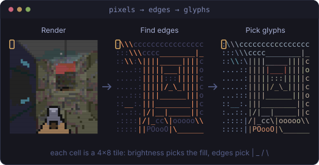
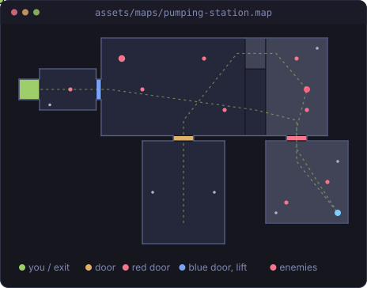

<div align="center">

<picture>
  <source media="(prefers-color-scheme: dark)" srcset="docs/readme/logo-dark.svg"/>
  
</picture>

**An old-school first-person shooter, drawn in ASCII in your terminal**

<a href="https://github.com/xuckless/gorescii/actions/workflows/ci.yml"></a> <a href="#license"></a>

[Build](#build) · [Controls](#controls) · [Make a level](assets/maps/README.md) · [How it works](#how-it-works)

</div>

## Build

```sh
cmake -S . -B build && cmake --build build -j
./build/gorescii
```

Needs a C++20 compiler and CMake 3.20 or newer, on macOS or Linux. No libraries. Use a truecolor terminal; Ghostty, kitty, WezTerm, foot and recent iTerm2 also report key releases, which makes movement feel right.

## Every frame is real ASCII

The world is rendered in 3D, then every terminal cell becomes one coloured character. These are frames from the game, not a video.



## From pixels to glyphs

Each cell covers a 4×8 tile of pixels. Brightness picks a fill from ` .:coPO?@#`, and where edges agree a line glyph `| _ / \` wins. The approach comes from [Acerola's ASCII shader](https://github.com/GarrettGunnell/AcerolaFX).



## Controls

Keyboard, mouse or both. A terminal can't capture the pointer, so resting it at the window edge keeps you turning.



<kbd>W</kbd><kbd>A</kbd><kbd>S</kbd><kbd>D</kbd> move · <kbd>←</kbd><kbd>→</kbd> turn · <kbd>Space</kbd> fire · <kbd>E</kbd> use · <kbd>1</kbd> <kbd>2</kbd> weapons · <kbd>Esc</kbd> pause · <kbd>C</kbd> colour · <kbd>V</kbd> edges · <kbd>M</kbd> mute

## Doors, lifts and keycards

Two original levels, joined into a campaign. Health, armour and ammo carry over. Levels are plain text files of convex sectors, so you can write your own.



```
sector floor=3 ceil=7 lift low=0 : 17,10 20,10 20,12 17,12
sector floor=3 ceil=5.5 door key=red : 10,14 10.5,14 10.5,16 10,16
thing redkey 15,16
```

The format is in [assets/maps/README.md](assets/maps/README.md). Play one map with `gorescii --map my.map`.

## How it works

```
sectors -> portal renderer -> colour, depth, surface ids -> sprites, weapon, flashes
        -> ASCII pass -> cells -> HUD -> only the changed cells, as truecolor escapes
```

- `src/render` walks from the camera's sector through portals and draws mipmapped walls, floors, sky and depth-tested sprites. Textures and sprite art are generated in code.
- `src/gfx` is the ASCII pass, Difference-of-Gaussians and Sobel edges, with depth and surface-id jumps standing in for normals, and the diffing presenter.
- `src/game` has the collision, enemies, weapons, doors, lifts and pickups. `src/audio` synthesises the sound effects and plays them through `afplay`, `paplay` or `aplay`.
- `src/term` handles raw mode, the kitty keyboard protocol and SGR mouse reporting.

Run `gorescii --help` for flags: `--style clean|lines|off`, `--mouse-sens`, `--no-mouse`, `--no-sound`, `--cell-width`, and `--snapshot 120x40` to print one frame as text.

## Develop

```sh
ctest --test-dir build --output-on-failure
cmake -S . -B build-asan -DCMAKE_BUILD_TYPE=Debug -DGORESCII_SANITIZE=ON
./build/gorescii_readme_art docs/readme      # redraw the animations above
```

The tests include a bot that plays through Pumping Station to prove it can be finished. The animations in this README are drawn by the engine itself.

## License

[MIT](LICENSE-MIT) or [Apache-2.0](LICENSE-APACHE), at your option.
